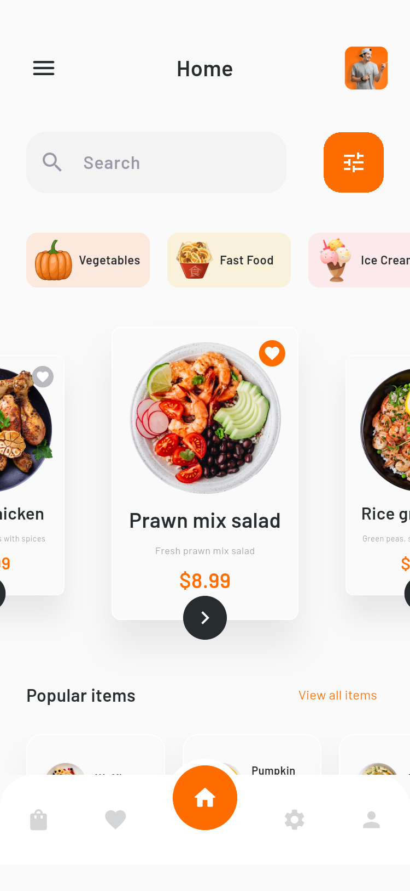
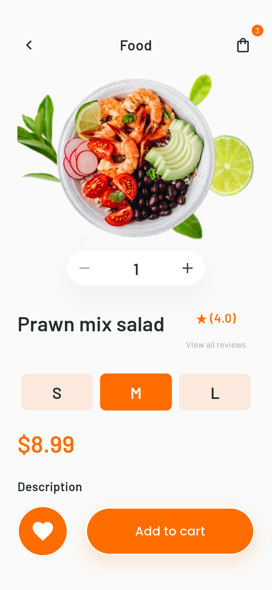
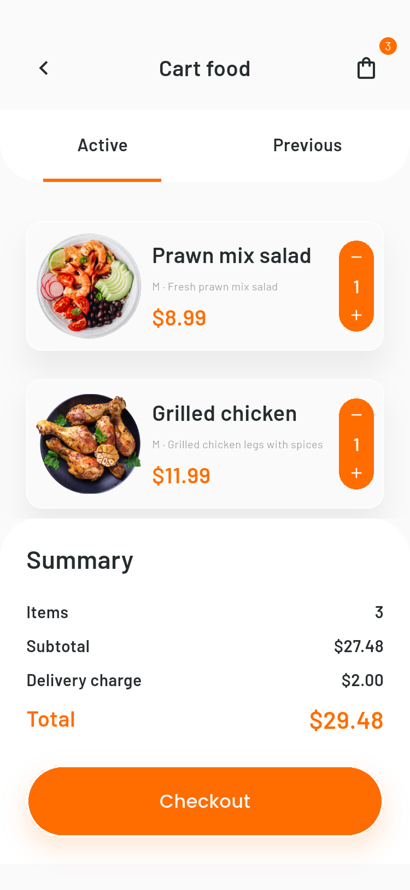
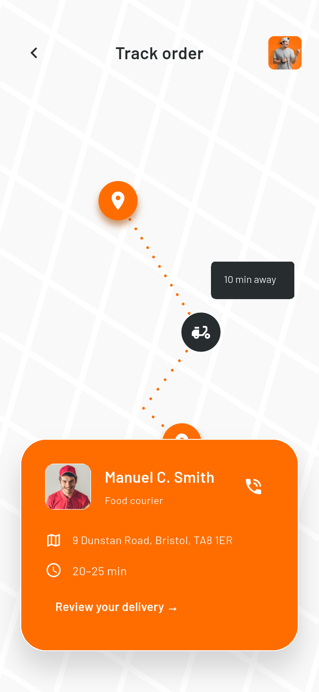
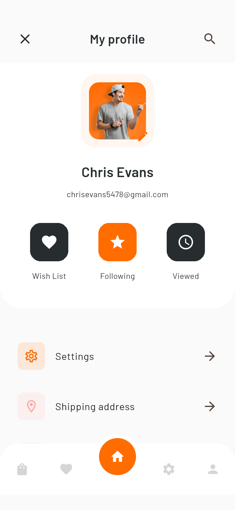
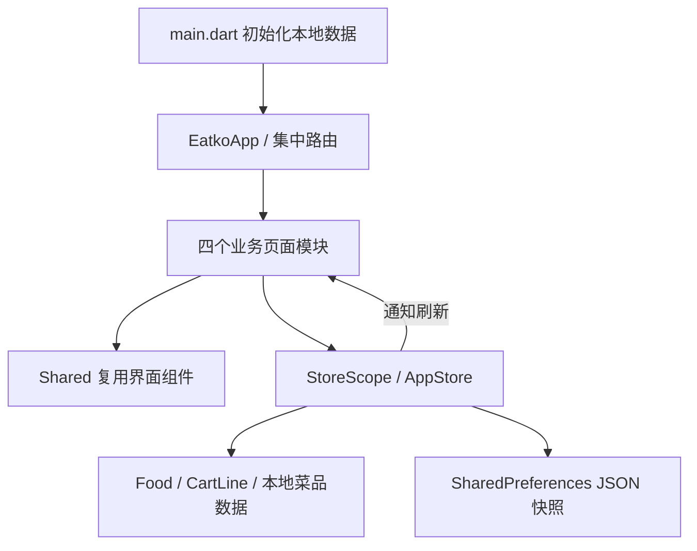

# Eatko · Flutter 外卖 App

根据 Pixso「Eatko food delivery ui kit」开发的可运行 Flutter 应用，覆盖「xd page」分类下的 Screen 01–25。保留英文界面、橙色品牌、Barlow/Poppins 字体、食物图片、插画和圆角控件，并修复原稿中重叠的文本与不一致的金额。

这是一个完整的本地交互演示：可浏览、搜索、筛选菜品，选择规格数量，收藏、编辑购物车、填写地址、模拟付款、查看配送示意和提交评价。登录、短信、支付与配送均未接入线上服务，不产生真实扣款或订单。

## 主要界面

以下图片来自实际 Android 模拟器运行，非设计稿替代截图。

| 首页 | 菜品详情 | 购物车 |
| --- | --- | --- |
|  |  |  |

| 配送跟踪 | 个人中心 | 登录 |
| --- | --- | --- |
|  |  |  |

[查看全部 25 页原稿和运行截图](docs/SCREENS.md) · [页面节点与路由清单](docs/design/manifest.json) · [测试记录](docs/VALIDATION.md)

## 启动方式

开发环境：Flutter 3.47.7 / Dart 3.13.5，Android SDK 36，测试模拟器 Android 15 / API 35。

```powershell
flutter pub get
flutter run -d <设备ID>
```

也可以运行 `flutter run -d chrome` 查看 Web 版。iOS 工程已生成，需在 macOS 安装 Xcode 后构建；本次未进行 iOS 模拟器或签名验证。

```powershell
flutter build apk --release
```

APK 构建输出位于 `build/app/outputs/flutter-apk/app-release.apk`。交付副本：[Eatko-1.0.0-demo.apk](dist/Eatko-1.0.0-demo.apk)。当前发布构建使用开发签名，适用于本地安装演示；正式上架时需配置自己的签名。

## 体验流程

1. 启动品牌页 → 三页引导 → 登录或注册。登录为本地表单演示，默认邮箱 `chrisevans5478@gmail.com`、密码 `eatko1234`；也可填写有效邮箱及至少 8 位密码。
2. 注册/找回密码的演示验证码为 **4973**。找回流程验证后返回登录，不发送真实短信或邮件。
3. 位置页可搜索并设置演示配送城市，也可暂时跳过；添加地址后返回地址确认。
4. 首页左右滑动菜品卡片；点击卡片进入详情，选择 S/M/L、调整数量并加入购物车。
5. 点击心形收藏；底部收藏入口查看收藏列表。个人中心的 Viewed 查看浏览记录。
6. 购物车 → Checkout → Add address → Save → Payment method → My card → 确认模拟订单。
7. 银行卡演示数据：`4242 4242 4242 4242`、CVV `123`、有效期 `12/30`。到期校验以设备当前时间为准；此数据仅用于本地表单演示。
8. 模拟支付成功后购物车清空，Previous 查看最近订单与金额；配送卡片可进入评价，评价保存在设备上。

## 页面与分类

Pixso 当前文件有 **1 个页面分类、25 个界面**，已逐一检查。未假定存在其他文件或分类。

| 业务模块 | 设计界面 | 内容 |
| --- | --- | --- |
| 认证与引导 | 01–12 | 品牌启动、三页引导、登录、注册、邮箱/手机找回、位置选择、手机号、验证码、成功页 |
| 菜单与发现 | 13–15、17 | 首页、菜品详情、搜索结果、食品筛选 |
| 订单与结算 | 16、18–22 | 购物车、地址编辑/确认、支付方式、银行卡、配送跟踪 |
| 个人与菜单 | 23–25 | 个人中心、配送评价、侧边菜单 |

页面路由使用 `'/01'` 到 `'/25'` 与设计编号一一对应，便于验收及回归截图。路由的集中定义位于 `lib/app.dart`。

## 项目结构

```text
EatkoFoodDelivery/
├── lib/
│   ├── main.dart                   # Flutter 入口与系统栏样式
│   ├── app.dart                    # App 根节点与 25 页路由
│   ├── core/
│   │   ├── models.dart             # 菜品、购物车条目、金额格式
│   │   ├── store.dart              # 共享状态、购物车计算、本地持久化
│   │   └── theme.dart              # 颜色、字体、输入框主题
│   ├── shared/
│   │   ├── widgets.dart            # 按钮、页头、导航、表单、卡片等
│   │   └── map_art.dart            # 配送地图/路径示意绘制
│   └── features/
│       ├── auth/auth_screens.dart
│       ├── catalog/catalog_screens.dart
│       ├── checkout/checkout_screens.dart
│       └── profile/profile_screens.dart
├── assets/
│   ├── images/                     # 从 Pixso 导出的透明图片与插画
│   └── fonts/                      # 本地字体与 SIL 开源授权
├── test/                           # 金额、持久化、页面布局、搜索测试
├── integration_test/app_test.dart  # 模拟器逐页截图与下单评价测试
├── test_driver/                    # 将模拟器截图写入文档目录
├── docs/
│   ├── design/                     # 25 张原稿、预览拼图、节点清单
│   ├── screenshots/                # 25 张 App 运行截图
│   ├── SCREENS.md                  # 全界面对照图册
│   └── VALIDATION.md               # 检查与构建记录
├── dist/                           # 可安装的 Android 演示包
└── android/ · ios/ · web/           # 平台工程
```

## 架构与数据流

采用 Flutter 自带的 `ChangeNotifier + InheritedNotifier` 管理跨页面状态，避免为 UI 演示引入额外状态框架。业务页面只持有输入框、选项卡和数量等临时状态；共享购物车、收藏、地址、资料和订单由 `AppStore` 统一维护。



- **展现层**：业务模块中的 Widget；统一使用主题和复用组件，滚动表单适配系统键盘。
- **状态层**：`AppStore` 负责收藏切换、规格合并、增减数量、订单提交和持久化；`StoreScope` 通知界面更新。
- **数据层**：`Food` 使用只读本地菜单，`CartLine` 记录菜品 ID、规格与数量。全部价格以整数「美分」计算，避免浮点误差。
- **存储层**：SharedPreferences 保存本地演示快照。地址的保存开关控制地址字段写入；支付偏好可记忆，完整卡号、CVV、有效期与密码均不写入存储。损坏的快照会回退到默认数据。

默认购物车金额为 `8.99 + 11.99 + 6.50 = 27.48`，配送费 `2.00`，总额 **29.48**。原稿的 27.50/29.50 与展示单价不一致，实现使用实际计算。S 规格比 M 减 1 美元，L 比 M 加 2 美元；不同规格分别计入购物车。

筛选基于本地样本菜单：Bristol 为可用城市；分类、金额区间、收藏优先、配菜和已下单筛选会影响结果。无匹配时显示空状态，不使用设计稿中的固定「224 items」。配送地图用 CustomPainter 重现浅色街道、橙色路径和定位点，是静态示意，不读取 GPS。

## 验证与截图复现

```powershell
flutter analyze
flutter test --concurrency=1
flutter drive --driver=test_driver/integration_test.dart --target=integration_test/app_test.dart -d <Android设备ID>
```

截图测试逐一打开 25 个路由，等待切换与绘制完成后保存 PNG；随后操作规格数量、加入购物车、地址确认、银行卡模拟付款和配送评价。运行截图测试会覆盖 `docs/screenshots/screen_01.png` 至 `screen_25.png`。本次截图使用 750×1624 像素 / 2× 密度，对应 375×812 逻辑尺寸。

## 代码整理与后续接入

已移除计数器示例和无用图标依赖；合并相似的引导、登录/注册、找回方式页面；共用页头、底栏、标签、表单和按钮；本地图片及字体无需运行时下载。运行依赖只保留 Flutter 与 SharedPreferences。

接入后端时可将 `AppStore.load/update/checkout` 的本地实现替换为仓储与 API，保留页面和模型边界；认证、短信、支付网关、地图定位及配送状态订阅需分别接入真实服务。当前按 UI 开发范围提供可运行的本地业务体验。
